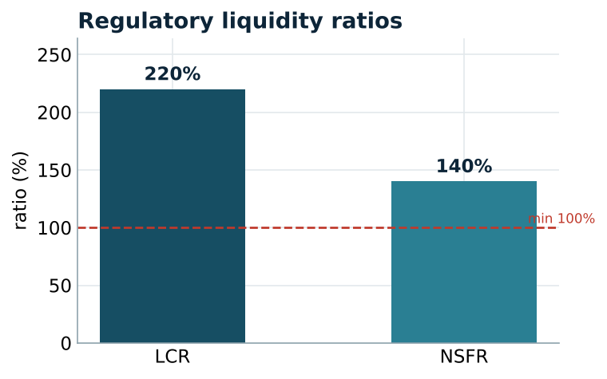
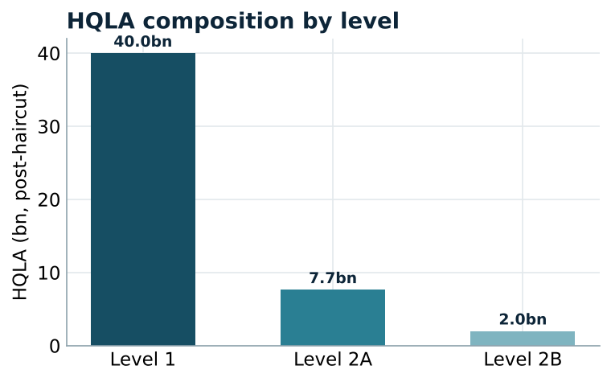
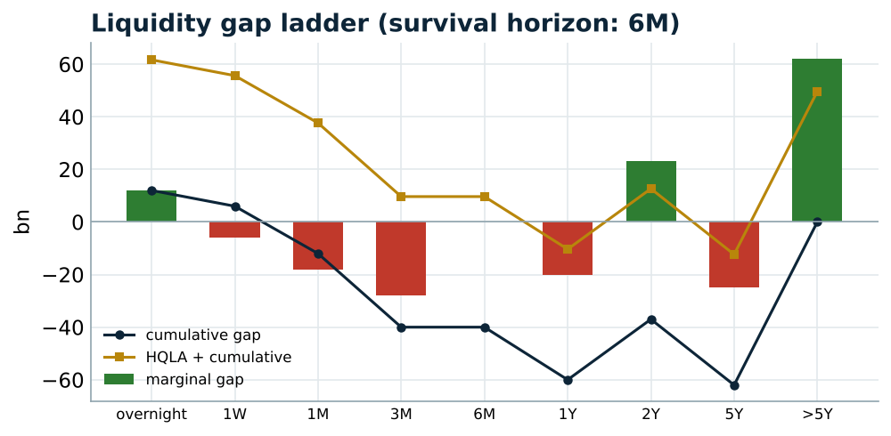
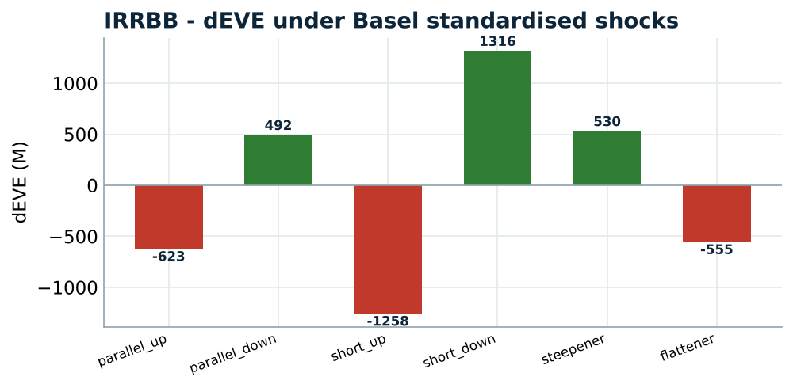

# Liquidity & ALM Risk Engine

🚀 **[Live dashboard](https://YOUR-APP.streamlit.app)** · 📄 **[Project report (PDF)](Liquidity_ALM_Project_Report.pdf)**

An end-to-end **liquidity and ALM risk** engine for a bank balance sheet: the two
Basel regulatory ratios (**LCR** and **NSFR**), a maturity-ladder **liquidity gap**
with a **survival horizon**, and **IRRBB** (interest rate risk in the banking book,
dEVE and dNII under the Basel standardised shocks). It is the Liquidity Risk /
ALM desk's core toolkit, built end to end.

Runs entirely in Google Colab, no token and no download required.

## Why this project

Mapped directly onto the BNP Paribas RISK offer's "Liquidity Risk Analyst"
mission: *identify, quantify and control the Market and Liquidity Risk of ALMT
activities* and *review the Liquidity Risk metrics (internal and regulatory)*.

| Offer / mission | Module in this repo |
| --- | --- |
| Review regulatory liquidity metrics (LCR) | `lcr.py` — HQLA tiers, caps, 30-day net outflows |
| Review regulatory liquidity metrics (NSFR) | `nsfr.py` — ASF vs RSF, structural funding |
| Quantify & control liquidity risk of ALM | `liquidity_gap.py` — maturity ladder, survival horizon |
| Interest-rate risk of ALM activities | `irrbb.py` — dEVE / dNII, Basel shocks, SOT |
| Develop monitoring tools & reporting | `app/streamlit_app.py` — 5-view dashboard |

## Pipeline

```
balance sheet → LCR → NSFR → liquidity gap & survival horizon → IRRBB (dEVE / dNII) → dashboard
```

## Key results

*Representative balance sheet: ~170bn assets, realistic HQLA / loan / funding mix.*

**Regulatory liquidity ratios**

| Ratio | Value | Minimum | Status |
| --- | --- | --- | --- |
| LCR (Liquidity Coverage Ratio) | 220% | 100% | PASS |
| NSFR (Net Stable Funding Ratio) | 140% | 100% | PASS |





**Liquidity gap** — the maturity ladder shows a survival horizon of **6M**: HQLA
plus the cumulative gap stays positive out to six months, after which the funding
profile would need rolling.



**IRRBB** — the worst dEVE is **-1,258M** under the short-rate-up shock, **7.4% of
Tier 1**, within the 15% Supervisory Outlier Test limit. dNII moves ±480M for a
±100bp parallel shock.



## Repo layout

```
src/   balance_sheet.py (ALM balance sheet) · lcr.py (LCR, HQLA, caps)
       nsfr.py (ASF/RSF) · liquidity_gap.py (maturity ladder, survival horizon)
       irrbb.py (dEVE/dNII, Basel shocks, SOT)
app/   streamlit_app.py — 5-view dashboard
tests/ test_liquidity.py — 13 passing tests
scripts/ run_pipeline.py — full report to stdout
notebooks/ 01_liquidity_alm.ipynb — the full Colab run
docs/  methodology.md — the one-page note
```

## Quickstart

```bash
pip install -r requirements.txt
python scripts/run_pipeline.py        # full liquidity & ALM report
pytest -q                             # 13 passing tests
streamlit run app/streamlit_app.py    # the dashboard
```

No data file and no token needed: the balance sheet is built deterministically.

## Methodology choices (see `docs/methodology.md`)

- **LCR** with the full HQLA tiering, haircuts and Level 2 / 2B caps.
- **NSFR** with Basel ASF and RSF factors.
- **Contractual vs behavioural maturity**: non-maturing deposits bucketed
  behaviourally for liquidity but immediately for repricing.
- **Survival horizon** from the counterbalanced cumulative gap.
- **IRRBB** dEVE under the six Basel shocks plus the dNII earnings view, checked
  against the Supervisory Outlier Test.

## Limitations & next steps

- Deposit behaviour is a single core assumption; a replicating-portfolio model
  would refine it.
- Cash flows are bucketed at midpoints; a dated cash-flow engine would sharpen dEVE.
- Intraday liquidity and collateral encumbrance are natural extensions.

*Stating the model's own assumptions explicitly is itself a second-line posture.*
